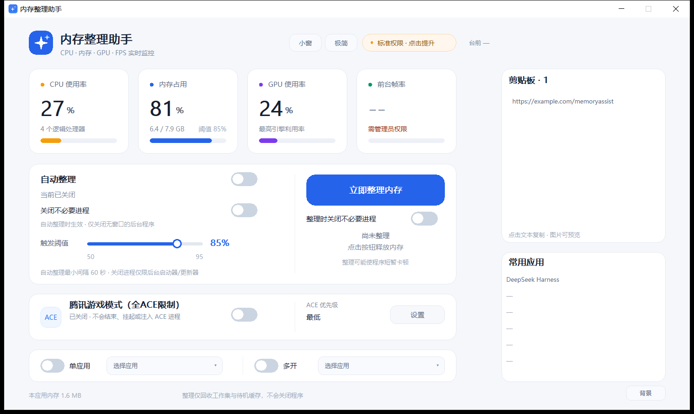
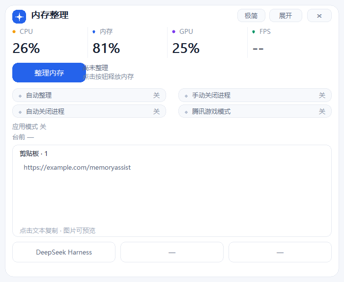
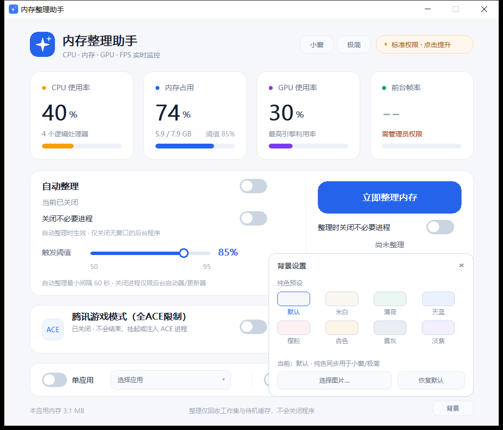
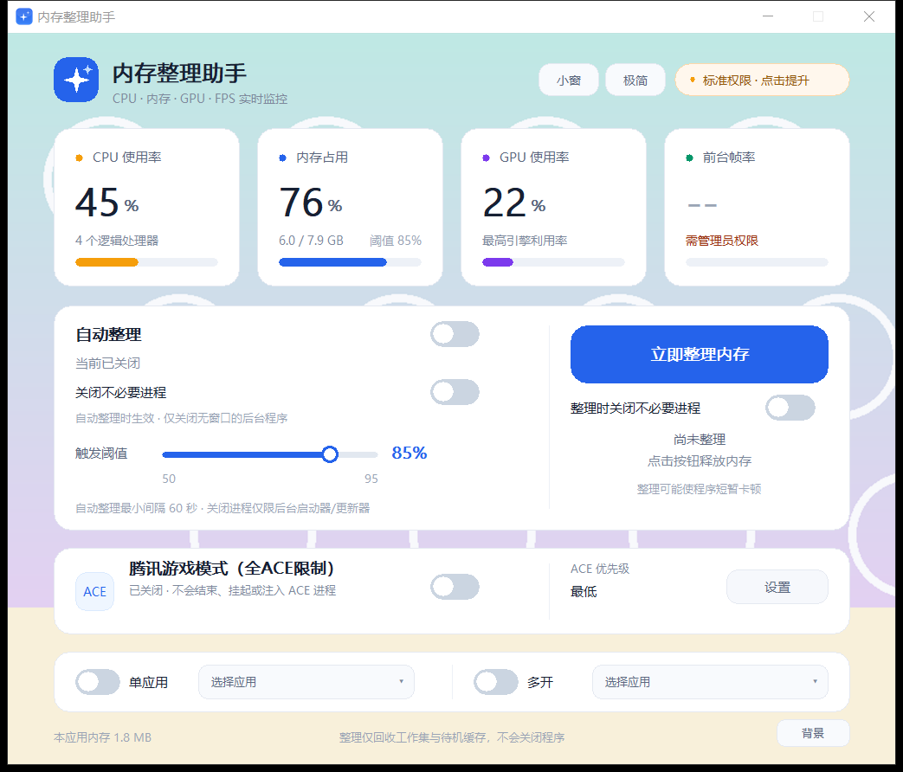
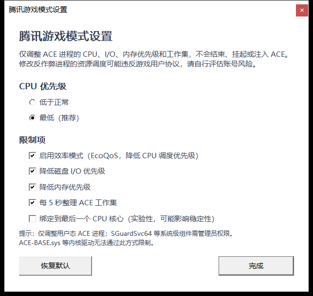

# 内存整理助手 · MemoryAssist

一个原生 Win32 的 Windows 内存监控与整理小工具。没有 Electron、没有 .NET 运行时、没有安装包，单个 exe 即可运行。










## 功能

- **实时监控**：CPU 使用率、物理内存占用、GPU 使用率、前台帧率，每秒刷新。
- **一键整理**：回收当前用户会话中各进程的工作集；管理员模式下额外清理系统待机列表。
- **自动整理**：拖动滑块设置 50%–95% 的触发阈值，打开开关后，内存达到阈值时自动整理。
- **关闭不必要进程**：两个独立的可选开关。按钮区的开关只作用于手动整理，自动整理区的开关只作用于自动整理。默认均关闭。
- **腾讯游戏模式（全ACE限制）**：识别并持续限制腾讯 ACE 反作弊的用户态进程，降低其 CPU、I/O、内存占用；支持优先级、EcoQoS、CPU 亲和性等设置。
- **单应用 / 多开模式**：两个独立开关，各自通过下拉列表选择运行中的应用。单应用为单选并全力提升该应用；多开为复选，同时提升多个应用，其余可见应用降级。
- **背景自定义**：完整窗口右下角 **背景** 按钮提供 8 种纯色预设，并可上传 PNG/JPG/BMP/GIF 图片作为主背景。图片只用于完整窗口；纯色预设同时改变小窗和极简模式的颜色。
- **剪贴板历史**：完整窗口右侧和小窗内显示最近 5 条剪贴板记录；文本点击即可复制链接/内容，图片显示“（图片）”并可点击预览、另存为 BMP，其他格式显示“（特殊格式）”。
- **常用应用**：完整窗口列出 6 个当前占用较高的可见应用，小窗列出 3 个，极简模式显示第一个；点击即可切到该应用。
- **台前应用**：完整窗口、小窗和极简模式都显示当前/最近台前应用，多个用 `/` 分隔。
- **小窗模式**：一键切换为 560×460 的置顶迷你窗口，显示 CPU、内存、GPU、FPS、整理按钮、全部开关状态、台前应用、剪贴板 5 行和 3 个常用应用；可拖动。
- **极简模式**：屏幕顶部居中的 1120×32 纯文字细条，显示 FPS、CPU、内存、GPU、ACE 状态、自动整理状态和阈值、应用模式、台前应用和第一个常用应用。
- **无效提示**：整理后仍高于阈值时，底部显示红色提示文字；如果窗口不在前台，会闪烁任务栏并发出提示音。自动整理同时暂停，避免反复整理拖慢系统。
- **极低占用**：原生 C++ / Win32 / GDI，exe 约 328 KB；启动后自动回收自身工作集，常驻工作集约 2–8 MB（使用自定义图片时略高）。
- **简洁界面**：单窗口，无广告、无捆绑、无后台服务、无网络请求。

## 使用

1. 双击 `MemoryAssist.exe`。这是绿色软件，不需要安装。
2. 主界面显示 CPU、内存、GPU 和前台 FPS 的当前数值。
3. 点击 **立即整理内存** 手动整理一次。下方会显示释放量、关闭的进程数和时间。
4. 拖动 **触发阈值** 滑块，打开 **自动整理** 开关。内存达到阈值后会自动整理，最小间隔 60 秒。
5. 如需在整理时关闭后台程序：
   - 打开按钮下方的 **整理时关闭不必要进程**，仅影响手动整理；
   - 打开自动整理区的 **关闭不必要进程**，仅影响自动整理。
6. 玩腾讯游戏时，可打开 **腾讯游戏模式（全ACE限制）**。点击右侧 **设置** 调整 ACE 限制方式。
7. 需要给某个或几个应用让出资源时：
   - 打开 **单应用** 开关并点击右侧下拉框，选择一个应用；
   - 或打开 **多开** 开关，点击 **选择应用**，在列表中勾选多个应用后点 **完成**。
8. 右侧 **剪贴板** 区域显示最近 5 条记录：点击文本行复制，点击“（图片）”预览并保存；下方 **常用应用** 点击即可切到该应用。
9. 点击右下角的 **背景**：
   - 选一个纯色预设，会同时改变完整窗口、小窗和极简模式的颜色；
   - 或点 **选择图片…** 上传自己的图片，图片只作为完整窗口背景，小窗和极简保持原色；
   - 点 **恢复默认** 回到默认背景。
10. 点击右上角的 **小窗** 或 **极简** 切换显示模式；右键任意模式窗口可打开模式菜单。
11. 如果整理后仍超过阈值，底部会出现红色提示。请关闭大型程序；如需更彻底的清理，点击右上角的 **标准权限 · 点击提升**，以管理员身份重启。

设置会自动保存在 `HKEY_CURRENT_USER\Software\MemoryAssist`。默认阈值为 85%，自动整理、关闭进程、腾讯游戏模式默认关闭。

## 背景自定义

完整窗口右下角的 **背景** 按钮会打开背景面板：

- **纯色预设**：默认、米白、薄荷、天蓝、樱粉、杏色、雾灰、淡紫。选择后完整窗口、小窗和极简模式同步换色。
- **选择图片…**：支持 PNG、JPG/JPEG、BMP、GIF。图片按比例裁切填充完整窗口，并加一层浅色蒙层保证文字可读。
- **图片只在完整窗口使用**：小窗和极简模式保持原来的白色/深色配色，不会把图片塞进小条。
- **恢复默认**：回到默认浅灰背景，小窗和极简也恢复原色。
- 上传的图片会复制到 `%LOCALAPPDATA%\MemoryAssist\background.*`，原图移动或删除后仍可使用；如果复制失败则直接引用原路径。
- 背景设置保存在注册表中，下次启动自动恢复。

## 剪贴板、台前应用与常用应用

- **剪贴板历史**：启动时读取当前剪贴板，之后监听 `WM_CLIPBOARDUPDATE`，新内容自动追加；相同内容只保留一条。
- 完整窗口右侧和小窗内显示最近 5 条；鼠标滚轮可翻阅更早记录。
- 文本记录点击即可复制完整内容（包括链接）；图片显示“（图片）”，点击打开预览窗口，可另存为 BMP；其他格式显示“（特殊格式）”。
- **台前应用**：记录最近 3 个前台应用，当前在前，多个用 `/` 分隔；本程序在前台时保留上一个目标。
- **常用应用**：按当前可见应用的工作集从大到小列出，完整窗口 6 个、小窗 3 个、极简模式显示第一个；点击即可恢复并切到该窗口。

## 小窗模式

小窗只保留最常用的信息和操作：

- CPU、内存、GPU、FPS 的文字数值；
- **整理内存** 小按钮，以及上次整理结果或“仍高于阈值”提示；
- 自动整理、手动关闭进程、自动关闭进程、腾讯游戏模式四个开关的 **开/关** 状态；
- 当前应用模式和应用名称（单应用显示一个；多开最多显示两个，以 `/` 分隔）；
- **台前应用**；
- **剪贴板 5 行**（文本点击复制，图片点击预览/保存）；
- **3 个常用应用**，点击切换；
- 右上角 **极简** 切换到极简模式，**展开** 返回完整界面，**×** 直接退出程序。

小窗为无边框设计，尺寸 560×460。进入时位于当前屏幕顶部居中并置顶，按住顶部标题区域即可拖动，拖动后仍保持置顶。小窗中的开关只显示状态，不直接修改；需要切换时展开完整界面即可。自动整理、关闭进程、腾讯游戏模式和应用模式在小窗状态下仍会继续工作。小窗状态不会持久化，重新启动默认显示完整界面。

## 极简模式

极简模式是屏幕顶部居中的 1120×32 纯文字细条，置顶且不占用任务栏，显示：

- FPS、CPU、内存、GPU；
- ACE 模式开启状态；
- 自动整理开启状态和当前阈值；
- 应用模式和应用名称：单应用显示一个；多开最多显示两个，以 `/` 分隔；
- **台前应用**（多个用 `/` 分隔）和 **第一个常用应用**；
- 最右侧 **展开** 切回小窗。

进入方式：完整界面右上角 **极简**，或小窗顶部 **极简**。极简模式下双击细条或点击 **展开** 可切回小窗；右键可打开“完整界面 / 小窗模式 / 极简模式 / 退出”菜单。退出程序请在小窗点 **×**，或从右键菜单选择“退出”。

## 应用模式（单应用 / 多开）

主界面底部的两个开关分别控制两种互斥模式：

| 模式 | 选择方式 | 选中应用 | 其他可见应用 |
| --- | --- | --- | --- |
| 单应用 | 单选，列表使用圆形单选标记 | `HIGH_PRIORITY_CLASS` | `IDLE_PRIORITY_CLASS` |
| 多开 | 多选，应用前有复选框 | `ABOVE_NORMAL_PRIORITY_CLASS` | `BELOW_NORMAL_PRIORITY_CLASS` |

- 点击 **选择应用** 下拉框，会列出当前有可见窗口的用户应用（按 exe 名称排序），不会列出系统服务、桌面 shell、输入法宿主等组件。
- 单应用模式选择后只显示一个应用；多开模式可勾选多个应用，点 **完成** 关闭列表。
- 只调整进程优先级，不结束、不挂起、不注入应用；同一 exe 的多个进程会一起调整。
- 如果选中的应用当前没有运行，程序不会限制其他应用；选中应用启动后会在下一次扫描（2 秒内）自动生效。
- 关闭对应开关或退出程序时，恢复原优先级。选择会保存在注册表中。
- 小窗和极简模式会显示当前模式与应用名称；多开超过两个时，显示工作集占用最大的两个，用 `/` 分隔。

## 实时帧率说明

- 帧率通过 Windows ETW 的 DXGI / D3D9 Present 事件统计当前前台进程最近 1 秒的呈现次数，不注入游戏、不读写游戏内存。
- **ETW 实时会话需要管理员权限**。标准权限下 FPS 显示 `--` 并提示“需管理员权限”；点击右上角 **标准权限 · 点击提升** 后重新打开即可启用。
- 只显示前台进程的帧率；点击本程序的小窗/极简条时会保留上一个前台目标。Vulkan、部分全屏独占或特殊渲染路径的游戏可能无法被 DXGI/D3D9 事件覆盖，此时显示 0 或 `--`。
- 如果已有其他程序占用了同名 ETW 会话，程序会尝试停止旧会话后重启。

## 腾讯游戏模式（全ACE限制）



打开主界面的开关后，程序每 2 秒扫描一次 ACE 组件，并对当前可访问的 ACE 用户态进程持续应用限制。开关关闭或程序正常退出时，会尝试恢复原来的 CPU 优先级和 CPU 亲和性。

### 识别的 ACE 组件

通过**进程名 + 安装路径**双重匹配，覆盖常见 ACE 版本：

- `SGuard64.exe`、`SGuardSvc64.exe`、`SGuard.exe`；
- `ACE-Guard Client.exe`、`ACE-Guard Client64.exe`、`ACE-Guard.exe`；
- `ACE-Tray.exe`、`ACE-Client.exe`、`ACE-Service.exe`、`ACE-Game.exe`；
- `AntiCheatExpert.exe`、`AntiCheatExpert Service.exe`；
- 安装目录包含 `AntiCheatExpert`、`ACE`、`ACE-Guard`、`SGuard`、`Tencent\ACE` 等路径的程序。

普通 ACE、无畏契约定制版，以及超自然行动组、迷你世界等常见游戏使用的 `SGuard64 / SGuardSvc64 / ACE-Guard` 组件都在匹配范围内。具体进程名可能随游戏版本变化，程序会按名称前缀和安装路径兜底识别。

### 可调整的设置

- **CPU 优先级**：低于正常 / 最低（默认最低）。
- **效率模式（EcoQoS）**：默认开启，降低 CPU 调度优先级。
- **降低磁盘 I/O 优先级**：默认开启，减轻 ACE 扫盘对磁盘的影响。
- **降低内存优先级**：默认开启。
- **每 5 秒整理 ACE 工作集**：默认开启，降低内存占用。
- **绑定到最后一个 CPU 核心**：默认关闭，实验性选项；启用后把 ACE 限制到最后一个逻辑核心。
- **恢复默认**：恢复上述默认值。

修改会立即保存，并在下一次 2 秒扫描时生效。启用 CPU 亲和性后，关闭开关或正常退出程序会自动恢复原亲和性。

### 权限和边界

- **仅调整用户态 ACE 进程**。`ACE-BASE.sys` 等内核驱动无法通过用户态 API 限制。
- `SGuardSvc64.exe` 等系统级组件通常需要管理员权限。标准权限下会显示"权限不足/建议管理员"，点击右上角提升权限后再开启即可。
- 不会结束、挂起、注入或 Hook ACE 进程，也不会修改游戏文件、读写游戏内存。
- 修改反作弊进程的调度优先级可能违反游戏用户协议，存在账号风险；请自行评估。如遇游戏启动、连接或反作弊异常，请立即关闭腾讯游戏模式。
- 如果程序被任务管理器强制结束，已应用的优先级/亲和性可能保留到 ACE 进程重启；通过界面关闭或正常退出可恢复。

## 关闭不必要进程的规则

这是可选功能，默认关闭。开启后，程序只会尝试关闭同时满足以下条件的进程：

- 位于当前用户会话；
- 属于内置安全名单：常见游戏启动器、后台辅助组件和更新器；
- **没有可见的顶层窗口**（最小化的窗口也算可见，因此正在使用、最小化但未退出的程序不会被关闭）；
- 不是当前前台程序、不是系统关键进程、不是本程序自身；
- 一次最多处理 12 个，先发送关闭消息，约 0.7 秒后仍在运行才强制结束。

安全名单包括：

- 游戏/平台启动器：Steam、Epic Games Launcher、Battle.net、Ubisoft Connect、EA Desktop、Origin、GOG Galaxy、Riot Client；
- 后台辅助：Xbox Game Bar、部分 Adobe / Google / Microsoft Edge / Office 更新器、Java 更新器、搜狗输入法云服务。

安全名单**不包含**网盘同步、聊天工具、办公软件、浏览器和系统服务。即使如此，关闭后台程序仍可能中断正在进行的下载或更新，请根据实际需要开启。

如果关闭进程开关是打开的，底部说明会变为"关闭进程仅限无可见窗口的后台启动器/更新器"；如果关闭失败，界面会提示"未发现可关闭的后台程序"。

## 两种权限模式

| 模式 | 可做的整理 | 适合场景 |
| --- | --- | --- |
| 标准权限 | 工作集回收 + 当前用户会话内的后台程序关闭 + 同用户 ACE 限制 | 日常使用，无需 UAC |
| 管理员模式 | 工作集回收 + 后台程序关闭 + 系统待机列表清理 + 系统级 ACE 限制 | 希望尽可能回收缓存、限制 ACE 服务时 |

管理员模式需要你在 UAC 提示中确认。没有管理员权限时，程序仍可正常监控和整理当前用户程序。

## 整理原理与边界

- 通过 `EmptyWorkingSet` 将进程工作集中的物理页转入待机列表；管理员模式下通过 `NtSetSystemInformation(SystemMemoryListInformation, MemoryPurgeStandbyList)` 清理待机缓存。
- 关闭进程功能关闭时，整理不会结束任何进程；开启后也只处理上述安全名单内的无窗口后台程序。
- 会跳过系统关键进程、Session 0 服务、DWM 等图形/安全进程。
- 工作集被清空后，程序再次访问这些页面时会产生缺页并重新读入，因此整理后部分程序可能短暂卡顿。这是正常现象。
- 内存整理不能"增加"物理内存，只能回收缓存和可换出的工作集。若大型程序仍占用大量内存，整理效果有限。
- 内存占用率来自 `GlobalMemoryStatusEx`，与任务管理器的"使用中"统计口径接近。
- GPU 使用率来自 Windows 的 `GPU Engine` 性能计数器，取各引擎实例聚合后的峰值。某些虚拟机、远程桌面或缺少性能计数器的驱动上可能显示 `--`。
- 自动整理在"整理后仍高于阈值"时会暂停，直到内存回落到阈值以下或你手动再次整理/重新开启开关。

## 系统要求

- Windows 10 / 11，64 位。
- 无需 .NET、Visual C++ 运行库或管理员权限即可启动。

## 构建

构建脚本只需要 Windows 10+ 和 PowerShell，自动下载并校验 Zig 0.14.1（自带 clang 与 Windows 头文件），不需要安装 Visual Studio。

```powershell
cd MemoryAssist
powershell -ExecutionPolicy Bypass -File .\build.ps1 -Clean -Package
```

- 如果本机没有 Zig，会下载到 `.tools\zig`，并用 SHA-256 校验官方压缩包。
- 输出：`dist\MemoryAssist.exe`。
- `-Package` 额外生成 `dist\MemoryAssist-v1.0-win64.zip`。
- `-Run` 构建完成后启动程序。

## 项目结构

```
MemoryAssist/
  src/main.cpp         原生 Win32 实现（监控、整理、ACE 限制、绘制）
  resources/app.rc     图标、清单、版本信息
  resources/app.ico    多尺寸应用图标
  resources/app.manifest
  build.ps1            一键构建
  docs/screenshot.png  主界面截图
  docs/compact.png     小窗模式截图
  docs/minimal.png     极简模式截图
  docs/settings.png    腾讯游戏模式设置截图
```

## 说明

- 这是未签名的个人工具，首次运行时 Windows SmartScreen 可能提示"未知发布者"；可核对下方 SHA-256 或自行从源码构建。
- 程序不联网、不写系统目录、不创建服务或计划任务；退出即完全停止。
- 自动整理采用保守策略：跳过关键进程、最小间隔 60 秒、无效后暂停。请根据实际体验调整阈值。

## 校验

当前发布的 `MemoryAssist.exe` SHA-256：

```text
19f7d8b7eba6ab47b52b8944a3a2dca58aa628b07f50c637bd54995a6b25b8c8
```

## 版本

v1.0 · MIT License
